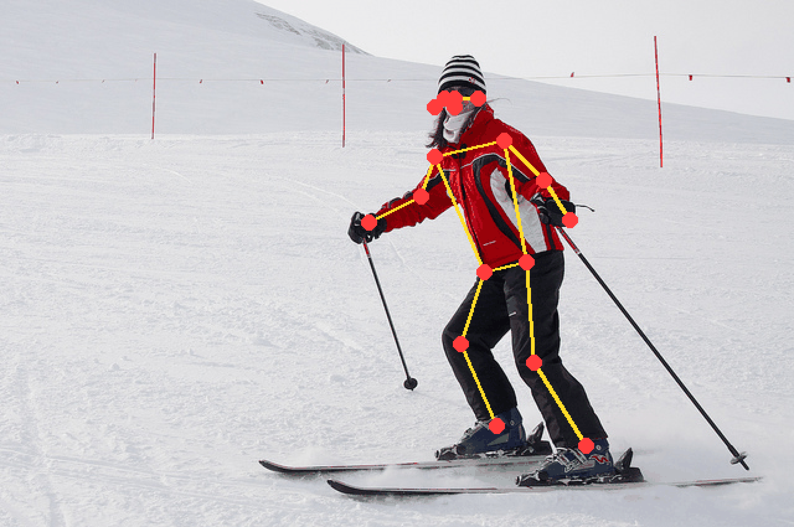

# Using ExecuTorch with CMSIS Developer Assistant

[](https://github.com/reinhardkeil/cmsis-executorch-pose/actions/workflows/test-cmsis-executorch-pose.yml)
[](https://open-cmsis-pack.github.io/cmsis-toolbox/)
[](https://www.keil.arm.com/packs/executorch-pytorch/)

This project started from the
[Arm-Examples/CMSIS-Executorch](https://github.com/Arm-Examples/CMSIS-Executorch)
template repository. That template supplied the TinyCNN examples, CMSIS
solutions, ExecuTorch integration, and MLOps flow for Corstone FVPs.

Using the CMSIS Developer Assistant, the template was extended into a
17-keypoint pose application for an Alif Ensemble DevKit-E7 with
Ethos-U55-256. The result covers model conversion and quantization, target
integration, building, flashing, SDS test-data streaming, hardware validation,
and visualization.



## What this work adds

Starting from the template, this work adds the complete pose-estimation path:

1. Describe the processor, NPU, Vela memory, and model input in CMSIS.
2. Export and quantize a PyTorch model with ExecuTorch.
3. Generate a target-specific CMSIS AI layer.
4. Build and run the same application on the Corstone-300 FVP and Alif E7.
5. Stream representative test data with SDS and validate the output on both.
6. Build both targets in CI and compare the FVP result with a tolerant reference.
7. Map keypoints back to the source photographs and generate an animated GIF.

| Added artifact | Purpose | Coverage |
| --- | --- | --- |
| `cmsis-executorch-pose.csolution.yml` | Google MoveNet Lightning pose application | Corstone-300 FVP and Alif DevKit-E7 / M55_HP / Ethos-U55-256 |
| `test_images/pose/` | Calibration-independent evaluation data, E7 result, FVP reference, transforms, and visualization | Three representative COCO images |
| `.github/workflows/test-cmsis-executorch-pose.yml` | Build and reference-test workflow | Builds both targets and runs the three-image FVP comparison |
| `tools/compare_pose_sds.py` | Tolerant SDS output comparator | Coordinates, confidence values, record structure, and non-finite values |
| `tools/view_pose_sds.py` | Pose renderer and GIF generator | Reverses letterboxing and overlays keypoints and skeletons on source images |
| `test_images/pose/pose_overlay_e7.gif` | Visual result from the E7 hardware run | Animated comparison across all three evaluation images |

The original `cmsis-executorch.csolution.yml` and
`cmsis-executorch-u55.csolution.yml` TinyCNN examples are retained from the
[template repository](https://github.com/Arm-Examples/CMSIS-Executorch) as
reference material; they were not created as part of the pose application.

## Prerequisites

- Git and Keil Studio for VS Code.
- CMSIS-Toolbox 2.15 or newer.
- Python `>=3.10,<3.14`, or `uv` for Python setup.
- Keil MDK Community or another suitable Arm Compiler license.
- An Alif DevKit-E7 and debug probe for hardware validation.

On Windows, enable
[long-path support](https://learn.microsoft.com/windows/win32/fileio/maximum-file-path-limitation#enable-long-paths-in-windows-10-version-1607-and-later).

## Quick start

Create the Python environment:

```powershell
.\setup_venv.bat --uv --python 3.12
```

On Linux or macOS, use `./setup_venv.sh --uv --python 3.12`. The environment
pins `executorch==1.5.1` to match `PyTorch::ExecuTorch@1.5.1`.

Open the repository in Keil Studio, select a `*.csolution.yml` in the CMSIS view,
then use the CMSIS **Build**, **Run**, or **Debug** actions. The generated AI
layers are committed, so the solutions build without first running Python.

Command-line examples:

```shell
cbuild cmsis-executorch-pose.csolution.yml --active SSE-300-U55-256
cbuild cmsis-executorch-pose.csolution.yml --active DevKit-E7-HP
```

After changing a model or target, regenerate its AI layer:

```shell
cbuild setup cmsis-executorch-pose.csolution.yml --active DevKit-E7-HP --packs
python create_ai_layer.py cmsis-executorch-pose.cbuild-mlops.yml
cbuild cmsis-executorch-pose.csolution.yml --active DevKit-E7-HP
```

On Windows, use `.\.venv\Scripts\python.exe`. The export reads the processor,
NPU, and Vela settings from `*.cbuild-mlops.yml`; target configuration is not
duplicated in the model code.

## Creating the pose application with CMSIS Developer Assistant

Starting from the
[CMSIS-Executorch template](https://github.com/Arm-Examples/CMSIS-Executorch)
with the Alif DevKit-E7 connected, these three prompts capture the essential
workflow. The resulting implementation is
described in [From template to an Alif E7 pose application](#from-template-to-an-alif-e7-pose-application).

1. **Create the application**

   > Use this ExecuTorch template to create a 17-keypoint pose-estimation
   > application from the Apache-2.0 Google MoveNet Lightning model. Target the Alif
   > DevKit-E7 M55_HP and Ethos-U55-256, retain the CMSIS MLOps flow, compile
   > the convolutional workload for the NPU, and preserve the model's bilinear
   > feature-pyramid resize.

2. **Add data and validate the hardware**

   > Add separate representative photographic data for INT8 calibration and
   > evaluation. Stream 192 x 192 RGB frames and pose results over USB SDS,
   > build and flash the application, then validate it on the connected Alif E7
   > using the SDSIO Server directly.

3. **Improve and document the coordinates**

   > Add MoveNet center, regression, heatmap, offset, and confidence decoding. Preserve the input
   > letterbox transform, map results back to the original photographs, generate
   > an animated result GIF, and document how to reproduce the test.

The CMSIS Developer Assistant checks the active target and session before using
CMSIS actions to build, flash, run, and inspect the board.

## From template to an Alif E7 pose application

The upstream CMSIS-Executorch template already provided the CMSIS solution
structure, ExecuTorch runtime integration, AI-layer generation, and TinyCNN FVP
examples. This work retained that architecture and added the Alif E7 target,
pose model and firmware, representative image data, SDS transport, coordinate
reconstruction, board validation, and result visualization.

### Model and quantization

`model/movenet_singlepose_lightning_raw.onnx` contains the backbone and four raw
heads extracted from Google's Apache-2.0 MoveNet Lightning float16 model. The
adapter in `model/pose_model.py` imports that graph into PyTorch, retains the
model's bilinear feature-pyramid resize, and exposes the heads to ExecuTorch.
Vela compiles the convolutional graph into four Ethos-U regions; three small
bilinear resize operations use the ExecuTorch portable kernel.

The generated [Vela summary](ai_layer_pose/vela_summary.txt) records the
compiler results for Ethos-U55-256 at 400 MHz with `RTSS_HP_SRAM_MRAM` and
`Shared_Sram`. Across the four delegated regions, Vela places all 164 reported
operators on the NPU and reports 270,765,792 MACs per inference. The portable
bilinear resize operations run outside these Vela regions.

| Region | NPU operators | MACs | SRAM used | Off-chip flash used | SRAM traffic | Flash traffic |
| ---: | ---: | ---: | ---: | ---: | ---: | ---: |
| 1 | 109 | 223,043,040 | 1,102.34 KiB | 2,271.86 KiB | 16.20 MB | 2.83 MB |
| 2 | 12 | 967,680 | 31.62 KiB | 8.11 KiB | 0.22 MB | 0.01 MB |
| 3 | 12 | 1,198,080 | 55.31 KiB | 2.95 KiB | 0.45 MB | 0.00 MB |
| 4 | 31 | 45,556,992 | 561.59 KiB | 27.73 KiB | 6.14 MB | 0.03 MB |

Memory use is reported per region and is not an additive application-memory
total. Regenerate both the AI layer and this report with `create_ai_layer.py`.

Eight photographs in `model/calibration_pose/` provide representative INT8
activation ranges. Random-noise calibration caused large coordinate errors on
occluded and distant people; photographic calibration corrected the hardware
results. `create_ai_layer.py` exports the quantized program into
`ai_layer_pose/`.

### Firmware and coordinates

`src/pose_app.cpp` receives 192 x 192 RGB888 frames over USB SDS, normalizes
them to `[-1, 1]`, and runs ExecuTorch. It decodes MoveNet's center heatmap,
keypoint regressions, per-keypoint heatmaps, and offsets into 17 normalized
coordinates with confidence values.

`tools/create_pose_sds.py` letterboxes three COCO validation photographs into
`Pose_In.0.sds` and records each resize and padding transform in
`Pose_In.transforms.json`.

After loading the firmware on the E7, run:

```shell
sdsio-server.py -c test_images/pose/pose.sdsio.yml --playback 0 \
  --exit-after-playback --no-progress-info --write-flush-records 0
```

Render the recorded board output on the original photographs:

```shell
python tools/view_pose_sds.py \
  test_images/pose/Pose_In.0.sds \
  test_images/pose/Pose_Out.0.p.sds \
  --save test_images/pose/pose_overlay_e7.gif --threshold 0.20
```

The viewer reverses the letterbox transformation before drawing the skeleton.
See [`test_images/pose/README.md`](test_images/pose/README.md) for data
provenance and file-format details.

## MLOps architecture

```text
*.csolution.yml
       | cbuild setup
       v
*.cbuild-mlops.yml  --->  create_ai_layer.py  --->  ai_layer*/
       |                                             |
       +---------------- cbuild ---------------------+
                             |
                             v
                    FVP or physical board
                             |
                             v
                      SDS validation data
```

CMSIS describes the hardware, Python produces a target-specific AI layer, and
the regular CMSIS build consumes that layer without invoking Python.

## CI testing

The single [GitHub Actions workflow](.github/workflows/test-cmsis-executorch-pose.yml)
builds the pose solution for both targets:

- `DevKit-E7-HP` verifies that the application, Alif board layer, USB SDS
  transport, ExecuTorch runtime, and committed AI layer compile together.
- `SSE-300-U55-256` builds the same application for the Corstone-300 FVP and
  runs an automated pose reference test on Ethos-U55-256.

The FVP test sets `SDSIO_FVP` to `test_images/pose/pose_fvp.sdsio.yml`. The
simulator's VSI3 implementation then acts as the SDSIO server: it plays the
three committed `Pose_In` frames, records `Pose_Out`, and stops after playback.
No separate SDSIO server or hardware connection is needed in CI.

`tools/compare_pose_sds.py` compares every returned value with the committed
FVP reference. It requires the same three timeslots and 17 keypoints, rejects
missing, duplicate, malformed, empty, or non-finite records, and applies
separate absolute tolerances:

- normalized x/y coordinate error: `0.02` (about 3.8 pixels at 192 x 192);
- keypoint-confidence error: `0.05`.

The tolerance absorbs small compiler and simulator numerical differences while
still detecting material pose regressions. The generated FVP output, SDSIO log,
and build products are uploaded when a job passes or fails.

All three evaluation images remain in the CI test. They cover an unobstructed
subject, a bent and partly occluded subject, and a small distant subject.

The Corstone-300 configuration sets `ethosu.extra_args=--fast`. This FVP option
accelerates Ethos-U execution for functional tests but deliberately sacrifices
cycle accuracy, so it must not be used for performance measurement. With the
AC6 Debug build and FVP 11.32.23, a local Windows run processed all three
images in about 23 seconds in fast mode, compared with about 7 minutes 5
seconds without it—approximately an 18x speedup. Both modes produced
byte-identical pose records in this test. FVP speed still depends on the host;
these figures estimate CI duration, not application performance on the E7.

FVP and hardware-in-the-loop (HIL) testing are complementary. FVP provides a
reproducible functional regression on every change. HIL remains necessary to
validate the real E7 memory system, Ethos-U integration, USB transport, timing,
and board behavior; the CI result must not be interpreted as an E7 hardware
pass.

The minimum prompts used to create this CI coverage were:

1. > Replace the obsolete template workflows with one build-and-test workflow
   > for the pose application. Build both the Alif DevKit-E7 and Corstone-300
   > targets without claiming hardware coverage in CI.
2. > Add a headless Corstone-300/Ethos-U55 FVP reference test using the
   > committed SDS pose frames. Preserve a reference output and compare new
   > results with explicit coordinate and confidence tolerances. Explain how
   > this complements HIL and document the measured simulation speed.

## Project layout

| Path | Purpose |
| --- | --- |
| `cmsis-executorch*.csolution.yml` | Target and MLOps configurations |
| `model/` | TinyCNN, the Apache-2.0 MoveNet ONNX checkpoint, adapters, and calibration data |
| `create_ai_layer.py` | Export, quantization, delegation, and AI-layer generation |
| `ai_layer/`, `ai_layer_pose/` | Generated target-specific AI layers |
| `src/` | ExecuTorch applications and embedded module wrapper |
| `board/` | Corstone and Alif board integrations |
| `sdsio/` | FVP, USB, and RTT SDS transports |
| `test_images/pose/` | Pose input, E7 output, transforms, and visualization |
| `documentation/` | Detailed MLOps and pack-maintenance notes |

## Adapting the project

To deploy another model:

1. Implement `get_model()` and `get_calibration_inputs()`.
2. Update the solution's `mlops.model` settings.
3. Regenerate the `*.cbuild-mlops.yml` and AI layer.
4. Update application input/output handling.
5. Validate with representative data on the intended target.

For camera models, prefer NHWC input so the first NPU convolution can absorb
the layout conversion.

## Further documentation

- [MLOps flow](documentation/mlops-flow.md)
- [ExecuTorch pack maintenance](documentation/executorch-pack-maintenance.md)
- [PyTorch ExecuTorch pack](https://www.keil.arm.com/packs/executorch-pytorch/)
- [ExecuTorch Arm Ethos-U backend](https://docs.pytorch.org/executorch/main/backends-arm-ethos-u.html)
- [CMSIS-Ethos-U](https://arm-software.github.io/CMSIS-Ethos-U/)
- [CMSIS-Toolbox MLOps](https://open-cmsis-pack.github.io/cmsis-toolbox/build-overview/#mlops-information)

## License

The template code is licensed under Apache-2.0; see [LICENSE](LICENSE).
`src/arm_embedded_module.*`, derived from ExecuTorch, uses BSD-3-Clause; see
[`src/LICENSE-ExecuTorch`](src/LICENSE-ExecuTorch).

The pose checkpoint is derived from
[Google MoveNet SinglePose Lightning 4](https://tfhub.dev/google/lite-model/movenet/singlepose/lightning/tflite/float16/4),
which is published under Apache-2.0. The COCO validation images retain their
individual source licenses; see [`test_images/pose/README.md`](test_images/pose/README.md).
